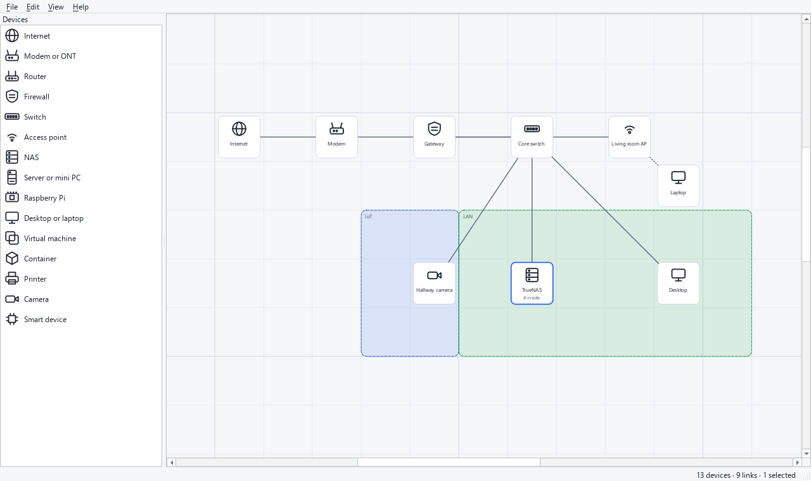

# HomeLabMaker

Draw your homelab on a grid and ask what can reach what.

HomeLabMaker is a desktop application for planning and documenting a homelab. You place
devices on a grid, nest virtual machines, containers and services inside their hosts,
join real ports with cables, and describe which service talks to which. From that model
it will tell you whether a flow can get from A to B, along which path, and what stops it.



*The window with the shipped example, whose devices and addresses are all invented. A dark
theme is [here](docs/images/homelabmaker-dark.png).*

> **Status: pre-alpha.** The editor works; the analysis does not exist yet. The roadmap
> below says exactly what is built and what is not.

## What works today

- **Place devices** from the list on the left: double-click (or press Enter on) a kind, or
  drag it onto the canvas. A device always lands on a free grid cell.
- **Move them** by dragging, or one cell at a time with the arrow keys. Cards snap to the
  grid, and a move onto a taken cell is refused instead of overlapping.
- **Select** by clicking or by dragging a rectangle, **rename** with a double-click or
  `F2`, **delete** with `Delete`. Deleting a device also removes what depended on it:
  its cables, its flows, what was inside it.
- **Undo and redo** every edit, up to 200 steps back.
- **Save and open** a project as one plain JSON file (`.homelab.json`) that diffs cleanly
  in git. A file that is broken, too large or from a newer version is refused with the
  place of the problem, and nothing is changed.
- **Zoom** with `Ctrl` and the wheel, **pan** with the middle button, **fit** everything
  in view, and choose a light, dark or system theme.
- **Open the example** (`examples/small-homelab.homelab.json`): a modem, a firewall with
  rules, a switch with VLANs, a NAS with virtual machines and containers inside it, and
  the cables, zones and flows between them. Devices inside a host are counted on the
  host's card ("4 inside") until nesting gets its own view.

## What does not exist yet

Nesting is in the model and the file but not yet drawn; cables, addresses, VLANs, flows,
zones and rules are in the model and the file but cannot yet be edited in the window, and
there is no reachability analysis. These come next, in this order (see the roadmap).

## What makes it different

- **Not a drawing tool.** In a diagramming tool a switch is a rectangle. Here a switch
  has the ports its kind says it has, and a project with nine cables on eight ports is
  refused when it is opened.
- **Not a network simulator.** It does not emulate vendor firmware or a command line.
  It reasons about the model you drew, and will say so next to every answer.
- **Built for a homelab.** Hosts contain virtual machines, which contain containers,
  which run services, and the catalogue is a NAS, a mini PC and a few switches rather
  than an exam topology.
- **Local only.** A project is a plain file on your disk. The application makes no
  network connection, has no account and sends nothing anywhere.

The full statement of purpose, of what it will never do, and of the model is in
[docs/scope.md](docs/scope.md).

## Run it from source

You need Python 3.11 or newer. On Windows, create the virtual environment on a short
path: Qt ships files whose paths exceed the 260-character limit when the project sits
in a deep folder.

```bash
python -m venv venv
venv/bin/pip install -e ".[dev]"   # Windows: venv\Scripts\pip
```

Start the application, optionally with a project to open:

```bash
python -m homelab_maker
python -m homelab_maker examples/small-homelab.homelab.json
```

`python -m homelab_maker --version` prints the version. There is no installer yet; a
Windows build can be made with `packaging\build-windows.ps1`, which produces a folder and
a zip.

## Where your data is

Your projects are wherever you save them. The only other file is `gui.ini` in your
configuration folder, which remembers the theme, the last folder and the window size.
`HOMELAB_MAKER_CONFIG_DIR` moves it. Nothing leaves your computer.

## Roadmap

- [x] Scope and project scaffold
- [x] Model and project file
- [x] Canvas: grid, devices, undo and redo, save and load
- [ ] Nesting drawn on the canvas, ports and links you can draw
- [ ] Addresses, VLANs and automatic checks
- [ ] Flows, reachability and the "what goes down" view
- [ ] Export (PNG, SVG, Markdown, draw.io) and an installer
- [ ] Later: rack view, power and cost, Discovery Now import, `docker-compose.yml` import

## Development

The four checks that CI runs:

```bash
ruff check .
ruff format --check .
mypy
pytest
```

The tests need neither a network nor a screen: the window is driven on Qt's invisible
platform with real mouse, key, wheel and drop events. See [CONTRIBUTING.md](CONTRIBUTING.md).

## About this project

Developed with the assistance of an AI coding assistant (Claude). Example data is
invented; no real network data is used anywhere in the repository.

## License

[MIT](LICENSE)
