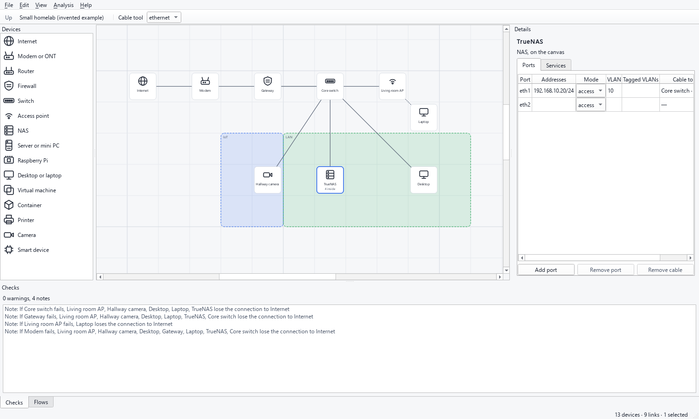
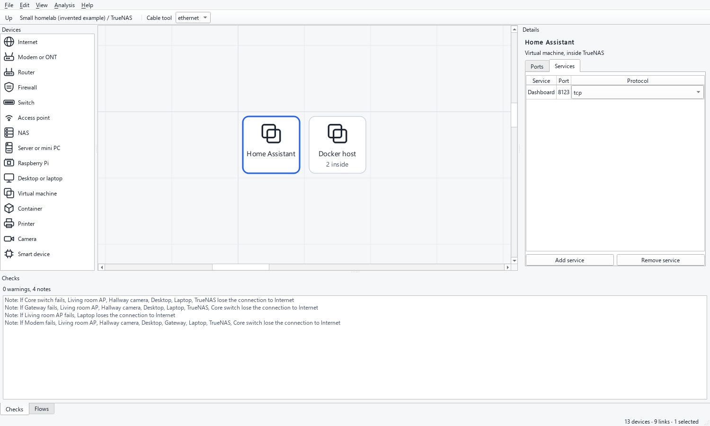
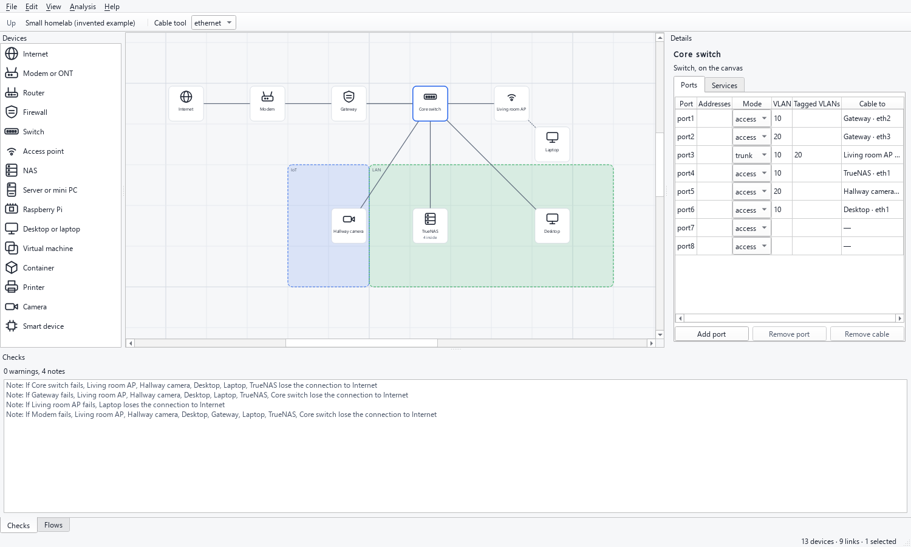
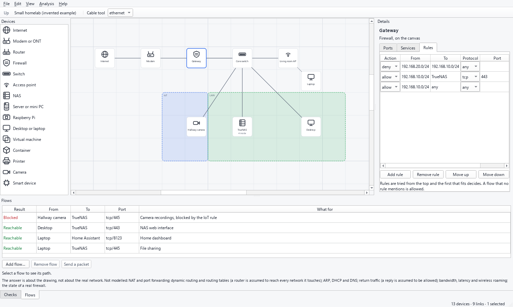
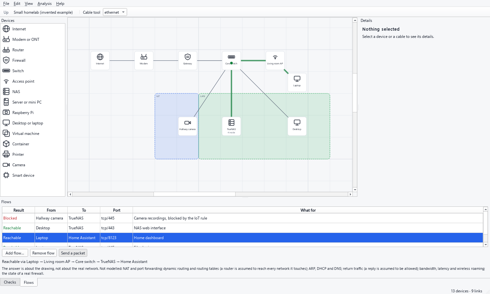
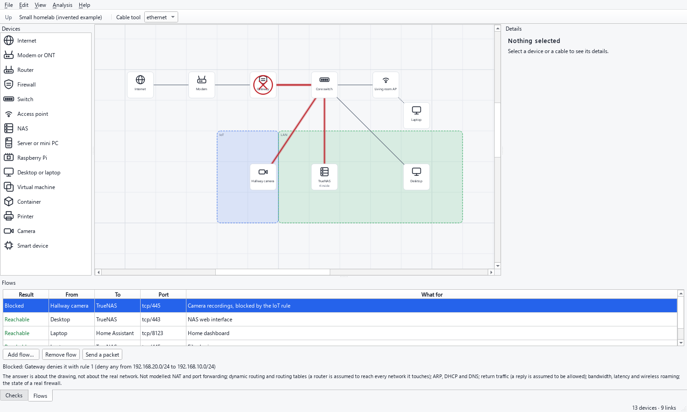
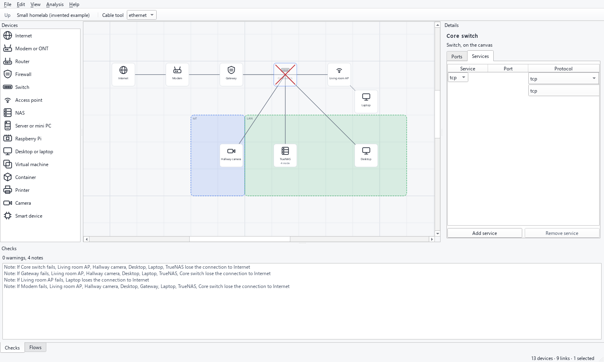

# HomeLabMaker

Draw your homelab on a grid and ask what can reach what.

HomeLabMaker is a desktop application for planning and documenting a homelab. You place
devices on a grid, nest virtual machines and containers inside their hosts, join real
ports with cables, and describe which service talks to which. From that model it tells
you whether a flow can get from A to B, along which path, and what stops it. It makes no
network connection of its own: a project is a file on your disk.



*The window with the shipped example, whose devices and addresses are all invented. A dark
theme is [here](docs/images/overview-dark.png).*

> **Status: first release (0.1.0), published as a pre-release.** Everything described
> below works and is tested; it has had no users yet, and the downloads are not signed.

## Download

Get the files from the [latest release](https://github.com/TrueScaleTech/homelab-maker/releases/latest).

> **Windows may warn you when you open the installer.** The files are not code-signed yet
> (a certificate costs money and needs a verified identity), and a new, little-downloaded
> file has no reputation with Microsoft, so SmartScreen shows "Windows protected your PC".
> That is expected. Check the file against `SHA256SUMS.txt` (below), then choose
> **More info**, then **Run anyway**. If you would rather not, run the application from
> source: see [Run it from source](#run-it-from-source).

| System | File | Notes |
| --- | --- | --- |
| Windows 10 or 11 | `HomeLabMaker-<version>-windows-x64-setup.exe` | Installs for the current user, no administrator rights. |
| Windows | `HomeLabMaker-<version>-windows-x64.zip` | Unzip anywhere and run `HomeLabMaker.exe`. |
| Linux (x86-64) | `HomeLabMaker-<version>-x86_64.AppImage` | Make it executable and run it. |
| Debian, Ubuntu and relatives | `homelab-maker_<version>_amd64.deb` | `sudo apt install ./homelab-maker_<version>_amd64.deb`, then start `homelabmaker`. |
| Linux | `HomeLabMaker-<version>-linux-x86_64.tar.gz` | Unpack and run `HomeLabMaker/homelabmaker`. |

`SHA256SUMS.txt` lists the checksum of every file. On Windows, compare it with the output of
`certutil -hashfile <file> SHA256`; on Linux, run `sha256sum -c SHA256SUMS.txt --ignore-missing`.
The Linux files were built on Ubuntu 22.04 and need a C library at
least as new as that one.

Every file is started once by the release workflow before it is attached, and the
installer is installed, run and removed there: see
[`.github/workflows/release.yml`](.github/workflows/release.yml).

## The modules

The window is made of a few parts. Each does one thing.

### The canvas: devices, nesting and cables



The grid is the drawing. Drag a kind from the **Devices** list onto it (or double-click a
kind) and a device lands on a free cell. A device has the ports its kind says it has: a
switch has eight, a firewall four, a NAS two.

- **Nesting.** A NAS, a server or a Raspberry Pi hosts virtual machines and containers; a
  virtual machine hosts containers. Press `Enter` on a host (or use the right-click menu,
  "Open inside") to see inside it, `Escape` to come back out. Drag a card onto a host that
  can hold it to put it inside. The trail at the top shows where you are.
- **Cables.** Switch on the **Cable tool** (`Ctrl+K`), then drag from one card to another,
  or click one and then the other. The cable takes the first free port of each. A cable
  fills a port, so a ninth cable on an eight-port switch is refused. Choose ethernet,
  fibre, wifi or a tunnel in the box next to the tool; wifi and tunnels get an interface of
  their own. Click a cable to select it, `Delete` removes it.
- **Zones.** *Edit, Add a zone around the selection* draws a named area (LAN, IoT,
  guests) behind devices.
- **Everything is undoable**, up to 200 steps, and the title shows when there is something
  unsaved.

### The details panel: ports, services and rules



Select a device and its details appear on the right.

- **Ports.** Each interface has addresses (IPv4 or IPv6, with a prefix), a mode (access or
  trunk), a VLAN (the untagged one) and, for a trunk, the tagged VLANs (`10, 30-32`). The
  last column says what the port is cabled to. A value that makes no sense is explained
  and the cell goes back to what it was.
- **Services.** What the device listens on: a name, a port and a protocol.
- **Rules.** Only on devices that route (a router or a firewall). Each rule allows or
  denies traffic from a source to a destination, optionally for one protocol and port.
  Source and destination are `any`, a network such as `192.168.20.0/24`, or a device by name.
  Rules are tried from the top and **the first that fits decides**; a flow that no rule
  mentions is allowed.



### The checks panel: what looks wrong

Warnings about the design appear as you draw, and never block anything:

- the same address on two devices;
- two ports joined by a cable that disagree about the VLAN (an access port on VLAN 10 cabled
  to one on VLAN 20, or a trunk that carries a VLAN the other end does not);
- two joined ports whose addresses are in different networks;
- a device with no cable, a routing port with a cable and no address;
- a single point of failure: a device whose failure cuts others off from the Internet.

Double-click a line to go to the device it talks about, even if it is inside a host. A
broken *file* is a different matter: a cable to a device that does not exist, a container
inside a switch, two cables on one port. Those are refused when the file is opened, because
the analysis relies on them.

### Flows and reachability



A **flow** says that one device talks to a port of another ("the laptop reaches the home
dashboard on tcp/8123"). Add one from *Analysis, Add flow* (`Ctrl+L`). Every flow is
analysed each time the drawing changes, and the **Flows** panel says *Reachable* or
*Blocked*. Select a flow to see its path on the canvas: green when it gets through, red
when it does not. *Send a packet* runs a dot along the path.

The analysis follows the cables you drew. Traffic crosses a link only if both ports carry
its VLAN. A VLAN changes only at a device that routes. The rules of every device that routes
on the way apply, first match wins. A switch, an access point and a modem pass traffic
along; a NAS or a PC is only ever the start or the end of a path. The destination must
list a service on the port, or, if it lists none, the answer says it did not check. A
virtual machine reaches the network through its host and is reached through it; a guest
with no VLAN of its own follows its host.



When a flow is blocked it says why and where: no chain of cables joins the two devices; a
cable joins two ports that share no VLAN (the cross sits in the middle of that cable); a
device denies it with rule 3; nothing listens on that port.

> **The answer is about the drawing, not about the real network.** It does not model NAT
> and port forwarding, routing tables (a router is assumed to reach every network it
> touches), ARP, DHCP and DNS, return traffic (a reply is assumed allowed), bandwidth and
> latency, wireless roaming, or the state of a real firewall. A virtual machine that itself
> routes (a firewall VM, say) is not placed on paths between other devices. The panel
> repeats this next to every answer.

### What goes down



Select one or more devices and choose *Analysis, What goes down if I switch off the
selection* (`Ctrl+Shift+D`). They are drawn faded and crossed out, with everything inside
them, and a message lists what is still running but cut off from the Internet, and which of
your flows stop working and why. *Back to normal* (`Ctrl+Shift+N`) puts it all back. The
drawing itself is not changed.

### Export

*File* offers three exports, all of what is on screen or in the project:

- **An image**, PNG or SVG, of the view that is open (without the grid or the selection).
- **The documentation**, a Markdown page: devices with their addresses and services, the
  links, every flow with its answer, the warnings, and what the analysis does not model.
- **A draw.io diagram** (`.drawio`), to open in diagrams.net and carry on there; hosts become
  containers with their guests inside.

The Markdown and draw.io files are written the same way every time, with no dates, so a copy
kept next to the infrastructure it describes diffs cleanly in git.

### The project file

A project is one plain JSON file, `name.homelab.json`: keys sorted, collections ordered by
id, the same homelab always giving the same bytes. It is data only; opening it never runs
anything. A file that is broken, too large (over 5 MiB), written by a newer version or
containing a field the application does not know is refused with the place of the problem,
and nothing is changed. Saving writes a temporary file first and replaces the old one only
when the new one is complete.

Open [`examples/small-homelab.homelab.json`](examples/small-homelab.homelab.json) to see a
whole homelab: a modem, a firewall with rules, a switch with VLANs, an access point, a NAS
with virtual machines and containers inside it, a camera on an isolated IoT network. All of
it is invented.

## Keys and mouse

| | |
| --- | --- |
| Place a device | double-click or `Enter` on a kind in the list, or drag it onto the grid |
| Move | drag, or the arrow keys (one cell) |
| Select | click, or drag a rectangle; `Ctrl+A` selects all |
| Rename, delete | `F2` or double-click; `Delete` |
| Open a host, come back out | `Enter` or `Alt+Down`; `Escape` or `Alt+Up` |
| Cable tool | `Ctrl+K`; `Escape` cancels a half-drawn cable, then leaves the tool |
| Add a flow, switch off, back to normal | `Ctrl+L`, `Ctrl+Shift+D`, `Ctrl+Shift+N` |
| Undo, redo | `Ctrl+Z`, `Ctrl+Y` (`Ctrl+Shift+Z` on Linux) |
| Zoom, fit, actual size | `Ctrl` and the wheel (or `Ctrl+=`, `Ctrl+-`), `Ctrl+1`, `Ctrl+0` |
| Pan | middle button |
| Theme | *View, Theme*: light, dark, or follow the system |

## What makes it different

- **Not a drawing tool.** In a diagramming tool a switch is a rectangle. Here a switch has
  the ports its kind says it has, and a project with nine cables on eight ports is refused.
- **Not a network simulator.** It does not emulate vendor firmware or a command line. It
  reasons about the model you drew, and says so next to every answer.
- **Built for a homelab.** Hosts contain virtual machines, which contain containers, which
  run services, and the catalogue is a NAS, a mini PC and a few switches rather than an exam
  topology.
- **Local only.** The application makes no network connection, has no account, no telemetry
  and no update check. A test reads every module and fails if one imports anything that
  could open a connection or run a program. See [SECURITY.md](SECURITY.md).

The full statement of purpose, of what it will never do, and of the model is in
[docs/scope.md](docs/scope.md).

## Run it from source

You need Python 3.11 or newer. On Windows, create the virtual environment on a short path:
Qt ships files whose paths exceed the 260-character limit when the project sits in a deep
folder.

```bash
python -m venv venv
venv/bin/pip install -e ".[dev]"   # Windows: venv\Scripts\pip
python -m homelab_maker
python -m homelab_maker examples/small-homelab.homelab.json
```

`python -m homelab_maker --version` prints the version. To build the packages yourself, see
`packaging/build-windows.ps1` (folder, zip and, with [Inno Setup](https://jrsoftware.org/isinfo.php)
installed, the installer) and `packaging/build-linux.sh` (folder, archive, `.deb` and
AppImage).

## Where your data is

Your projects are wherever you save them. The only other file is `gui.ini` in your
configuration folder, which remembers the theme, the last folder and the window size.
`HOMELAB_MAKER_CONFIG_DIR` moves it. Nothing leaves your computer.

## Roadmap

Done: the model and the project file, the canvas, nesting and cables, addresses, VLANs and
checks, flows and reachability, what goes down, exports, installers. Ideas for what comes
next, such as a rack view, power and cost, importing a `docker-compose.yml` or a Discovery
Now export, and a command-line check for CI, are in [docs/evolutions.md](docs/evolutions.md).

## Development

The four checks that CI runs:

```bash
ruff check .
ruff format --check .
mypy
pytest
```

The tests need neither a network nor a screen: the window is driven on Qt's invisible
platform with real mouse, key, wheel and drop events. See [CONTRIBUTING.md](CONTRIBUTING.md)
for how the code is divided and the house rules, and [CHANGELOG.md](CHANGELOG.md) for what
each release contains.

## About this project

Developed with the assistance of an AI coding assistant (Claude). Example data is invented;
no real network data is used anywhere in the repository.

## License

[MIT](LICENSE)
